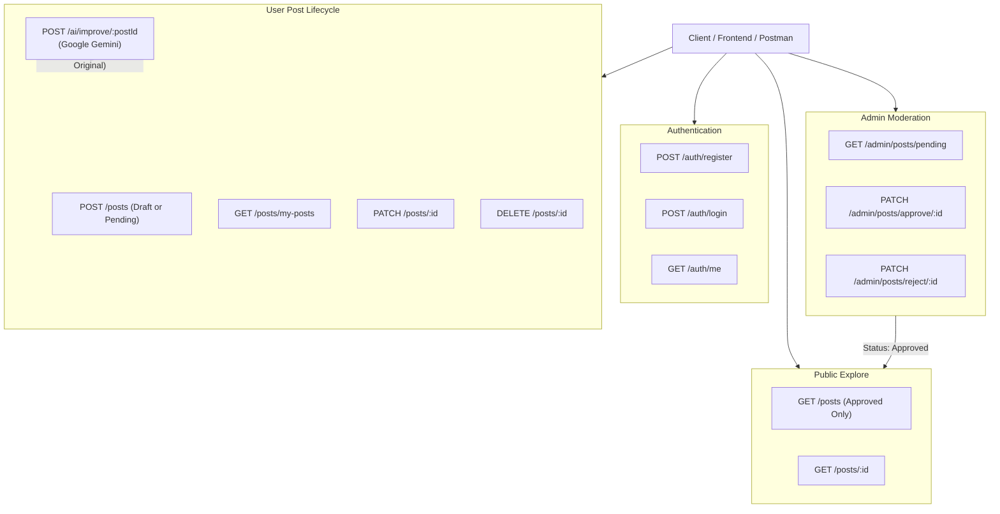

# 🏮 Akatsuki's Draft: AI-Enabled Content Sharing Platform (Backend)

[](https://github.com)
[](https://nodejs.org/)
[](https://expressjs.com/)
[](https://mongoosejs.com/)
[](https://jwt.io/)
[](https://ai.google.dev/)

---

## 📌 Project Overview

**Akatsuki's Draft** is a backend system developed for **Nodevember 4.0**. It powers a secure, AI-assisted content-sharing platform where authors can create, draft, manage, and enhance their articles using **Google Gemini AI**, while administrators maintain platform quality through an approval workflow.

### Key Highlights:
1. **Role-Based Access Control (RBAC)**: Distinguishes between standard `user` and `admin` roles.
2. **Secure Authentication**: Passwords hashed with `bcryptjs` and stateless session management with **JWT (JSON Web Tokens)**.
3. **Draft & Publishing Workflow**: Authors can save posts as drafts or submit them as pending for administrative review.
4. **Admin Moderation**: Dedicated endpoints for admins to inspect pending posts, approve them for public display, or reject them with feedback.
5. **AI Content Improvement**: Integrates **Google Gemini API** (`@google/generative-ai`) to rewrite, polish, and structure drafts. **Preserves the original draft intact** and saves the AI-enhanced version as a brand-new draft under the same user with a unique ID.
6. **Robust Error Handling & Validation**: Centralized error middleware handling Mongoose validations, unique constraint errors, and invalid ObjectIds.
7. **Postman & Thunder Client Ready**: Pre-configured collection file included in the repository for one-click testing.

---

## 🏗️ Architecture & Workflow



---

## 📊 Database Schema Design

### 1. User Schema (`User`)
| Field | Type | Required | Description |
|---|---|---|---|
| `name` | String | Yes | Author's full name |
| `email` | String | Yes | Unique, lowercase email address |
| `password` | String | Yes | Bcrypt-hashed password (hidden by default) |
| `role` | String | Yes | Enum: `'user'` \| `'admin'` (default: `'user'`) |
| `createdAt` | Date | Auto | Timestamp of account creation |

### 2. Post Schema (`Post`)
| Field | Type | Required | Description |
|---|---|---|---|
| `title` | String | Yes | Headline of the post |
| `description` | String | No | Short synopsis / excerpt |
| `content` | String | Yes | Main body / Markdown content |
| `image` | String | No | URL or local path to uploaded image |
| `category` | String | No | Category tag (e.g., Tech, Life, Anime) |
| `createdBy` | ObjectId | Yes | Reference to `User` (`_id`) |
| `status` | String | Yes | Enum: `'draft'` \| `'pending'` \| `'approved'` \| `'rejected'` (default: `'draft'`) |
| `originalPostId` | ObjectId | No | Link to parent draft if generated via AI |
| `aiImproved` | Boolean | No | Flags if content was enhanced by AI |
| `adminFeedback`| String | No | Optional feedback note from admin |
| `createdAt` | Date | Auto | Timestamp of post creation |

---

## 🚀 API Specification

### 1. Authentication Endpoints

#### Register a New User
- **Endpoint**: `POST /auth/register`
- **Access**: Public
- **Request Body**:
```json
{
  "name": "Naruto Uzumaki",
  "email": "naruto@leaf.org",
  "password": "Password123",
  "role": "user"
}
```
- **Response** `(201 Created)`:
```json
{
  "success": true,
  "message": "User registered successfully.",
  "token": "eyJhbGciOiJIUzI1NiIsIn...",
  "user": {
    "id": "673f1a2b...",
    "name": "Naruto Uzumaki",
    "email": "naruto@leaf.org",
    "role": "user"
  }
}
```

#### Log in
- **Endpoint**: `POST /auth/login`
- **Access**: Public
- **Request Body**:
```json
{
  "email": "naruto@leaf.org",
  "password": "Password123"
}
```
- **Response** `(200 OK)`: Returns JWT token and user profile.

#### Get Current User Profile
- **Endpoint**: `GET /auth/me`
- **Access**: Private (Requires `Authorization: Bearer <token>`)

---

### 2. User Post Management

#### Create Post or Draft
- **Endpoint**: `POST /posts`
- **Access**: Private
- **Request Body**:
```json
{
  "title": "Introduction to Node.js Microservices",
  "description": "A beginner's guide to distributed backend architectures.",
  "content": "Node.js offers asynchronous I/O and non-blocking event loops...",
  "category": "Technology",
  "status": "draft"
}
```
*(Set `status: "pending"` to directly submit for admin approval, or leave as `"draft"`).*

#### Explore Approved Posts
- **Endpoint**: `GET /posts`
- **Access**: Public
- **Query Params**: `?category=Technology&search=node&page=1&limit=10`
- **Description**: Returns only posts with `status: "approved"`.

#### Get Post by ID
- **Endpoint**: `GET /posts/:id`
- **Access**: Public (Approved posts visible to all; drafts/pending visible to owner/admin).

#### Get My Posts and Drafts
- **Endpoint**: `GET /posts/my-posts`
- **Access**: Private
- **Description**: Returns all posts authored by the authenticated user across all statuses (`draft`, `pending`, `approved`, `rejected`).

#### Update Post
- **Endpoint**: `PATCH /posts/:id`
- **Access**: Private (Post Owner / Admin)
- **Request Body**: Any editable field (`title`, `content`, `status`, etc.).

#### Delete Post
- **Endpoint**: `DELETE /posts/:id`
- **Access**: Private (Post Owner / Admin)

---

### 3. AI Content Improvement

#### Improve Draft with Google Gemini
- **Endpoint**: `POST /ai/improve/:postId`
- **Access**: Private (Post Owner / Admin)
- **Request Body** *(Optional custom instruction)*:
```json
{
  "instruction": "Make the tone professional, enhance formatting with markdown headers, and fix any grammar issues."
}
```
- **Behavior**:
  1. Retrieves the original draft.
  2. Sends content to **Google Gemini AI** with an editorial prompt.
  3. **Creates a new post** with `status: "draft"`, linked to `originalPostId`.
  4. Leaves the original draft unchanged.
- **Response** `(201 Created)`:
```json
{
  "success": true,
  "message": "Post successfully improved with AI and saved as a new draft.",
  "aiEngine": "gemini-api",
  "improvementsSummary": "Enhanced structure, added subheadings, and polished grammar.",
  "newDraft": {
    "_id": "673f1d9c...",
    "title": "Introduction to Node.js Microservices (AI Enhanced)",
    "content": "## Architectural Overview\n\nNode.js utilizes...",
    "status": "draft",
    "aiImproved": true,
    "originalPostId": "673f1a2b..."
  },
  "originalDraftPreserved": {
    "id": "673f1a2b...",
    "title": "Introduction to Node.js Microservices",
    "status": "draft"
  }
}
```

---

### 4. Admin Post Approval

#### View Pending Posts
- **Endpoint**: `GET /admin/posts/pending`
- **Access**: Private (Admin role only)
- **Description**: Returns all posts waiting in the moderation queue (`status: "pending"`).

#### Approve Post
- **Endpoint**: `PATCH /admin/posts/approve/:id`
- **Access**: Private (Admin role only)
- **Request Body** *(Optional)*:
```json
{
  "feedback": "Well written, approved for publication."
}
```

#### Reject Post
- **Endpoint**: `PATCH /admin/posts/reject/:id`
- **Access**: Private (Admin role only)
- **Request Body** *(Optional)*:
```json
{
  "feedback": "Needs citations and deeper examples."
}
```

---

## ⚙️ Installation & Setup

### Prerequisites
- [Node.js](https://nodejs.org/) (v18.0.0 or higher)
- [MongoDB](https://www.mongodb.com/try/download/community) running locally or a [MongoDB Atlas](https://www.mongodb.com/cloud/atlas) connection URI.
- (Optional) [Google Gemini API Key](https://aistudio.google.com/app/apikey) for AI features.

### Step 1: Clone or Extract the Project
```bash
git clone <your-repository-url>
cd akatsuki-draft-backend
```

### Step 2: Install Dependencies
```bash
npm install
```

### Step 3: Configure Environment Variables
Copy `.env.example` to `.env`:
```bash
cp .env.example .env
```
Edit `.env` with your values:
```env
PORT=5000
NODE_ENV=development
MONGO_URI=mongodb://127.0.0.1:27017/akatsuki_draft
JWT_SECRET=your_super_secret_jwt_key
GEMINI_API_KEY=YOUR_GEMINI_API_KEY_HERE
```
> **Note**: If `GEMINI_API_KEY` is not provided, the system automatically runs an intelligent offline enhancement fallback so the application runs without errors out of the box!

### Step 4: Run the Server
```bash
# Start in production mode
npm start

# Or start in development mode with auto-reload
npm run dev
```
The server will start at `http://localhost:5000`.

---

## 🧪 Testing with Postman
1. Open Postman or Thunder Client in VS Code.
2. Click **Import** and select `postman_collection.json`.
3. Set your collection variables:
   - `baseUrl`: `http://localhost:5000`
   - `userToken`: Paste the JWT returned from `/auth/login` (User).
   - `adminToken`: Paste the JWT returned from `/auth/login` (Admin).
   - `postId`: Paste the `_id` of a created post.

---

## 📁 Project Structure

```
akatsuki-draft-backend/
├── .env.example              # Environment variables template
├── .gitignore                # Git ignore configuration
├── package.json              # Project dependencies and npm scripts
├── postman_collection.json   # Ready-to-import Postman API collection
├── README.md                 # Detailed documentation
├── server.js                 # Application entry point
├── uploads/                  # Upload directory for post attachments
│   └── .gitkeep
└── src/
    ├── config/
    │   └── db.js             # Mongoose MongoDB connection
    ├── controllers/
    │   ├── authController.js # Register, Login, Me handlers
    │   ├── postController.js # CRUD for posts & drafts
    │   ├── adminController.js# Pending queue, Approve, Reject
    │   └── aiController.js   # Gemini AI content improvement
    ├── middleware/
    │   ├── authMiddleware.js # JWT verification & Admin guard
    │   ├── errorMiddleware.js# 404 and global error handlers
    │   └── uploadMiddleware.js# Multer for file/document uploads
    ├── models/
    │   ├── User.js           # User schema with bcrypt hashing
    │   └── Post.js           # Post schema with status workflow
    ├── routes/
    │   ├── authRoutes.js     # /auth router
    │   ├── postRoutes.js     # /posts router
    │   ├── adminRoutes.js    # /admin router
    │   └── aiRoutes.js       # /ai router
    └── utils/
        ├── generateToken.js  # JWT signer helper
        └── geminiHelper.js   # Gemini AI integration & fallback
```

---

## 📜 FreeCodeCamp & Gemini Documentation Links
- [FreeCodeCamp Back End Development and APIs Certification](https://www.freecodecamp.org/learn/back-end-development-and-apis-v9/)
- [Google Gemini API Document Processing Documentation](https://ai.google.dev/gemini-api/docs/document-processing?authuser=1#javascript)

---

## 👥 Authors
Built for **Nodevember 4.0** — **Akatsuki Team**.
Licensed under the [MIT License](LICENSE).
